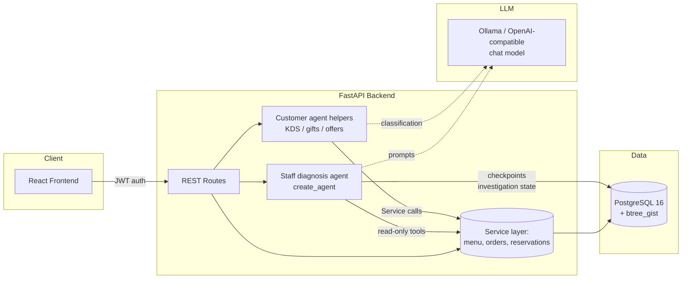
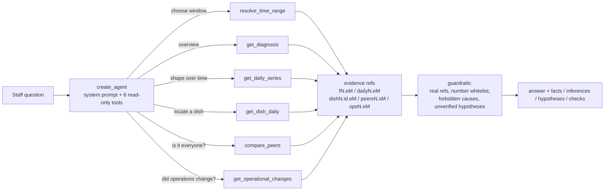

# Architecture — Multi-Branch Restaurant AI Agent

This document covers the technical decisions behind GourmetBistro AI: how the agent surfaces are structured, how data integrity is guaranteed despite an LLM being in the request path, and a log of real bugs found and fixed during development — included deliberately, because the debugging process is as representative of the engineering here as the final code.

## System overview



Two paths into the database: ordinary REST CRUD routes (no LLM involved — staff and self-service actions should be deterministic and fast), and the staff diagnosis agent, which reaches the same Service layer through read-only tools. The customer agent helpers (kitchen-contact classification, gift suggestions, booking offers) also call Services; they are business endpoints that consult the Agent, not a chat surface. The LLM never touches the database directly — it can only trigger a fixed set of tool or helper functions, each of which enforces its own validation.

## The agent surfaces

There is no standalone customer chat endpoint. The legacy multi-node LangGraph `StateGraph` (`agent/graph.py`, `agent/nodes/*`, its flows/labels/state helpers, and the tools that only it used) was removed on 2026-10-17: it was never wired to a route, and keeping it made the architecture look like a live chat path that did not exist.

What remains is two deliberately different agent surfaces:

- **Staff diagnosis investigation** — the bounded ReAct agent described below, mounted at `POST /api/staff/diagnosis/investigate`.
- **Customer agent helpers** — `agent/kds.py` classifies a customer's free-text message to the kitchen (hold / resume / status) and moves the simulated KDS state; `agent/approvals.py` proposes a gift for a gated order; `agent/offers.py` proposes the nearby booking time and gift when a table is full. Each is invoked from a business route and delegates persistence and permission checks to a Service.

**Why customer identity is never model input:** the helpers take the customer's identity from the authenticated JWT, and the route checks order/table ownership through the Service before the helper runs. A customer cannot look up or act on someone else's order by asking the model to fetch an arbitrary ID. The trust boundary is the auth layer, not the model's judgment.

**Handling a small, less reliable model:** DeepSeek R1 (run locally via Ollama, chosen for zero cost) emits `<think>...</think>` reasoning traces before its actual output and is meaningfully less reliable at structured tool-calling than a hosted frontier model. `agent/llm.py` includes a defensive parser that strips reasoning traces (including unclosed ones, if the model runs out of tokens mid-thought), and attempts to extract/repair JSON from the response before falling back to a rule-based reply if parsing still fails. This is a direct, deliberate trade-off of the zero-cost constraint: reliability work that a hosted model would make unnecessary.

## The diagnosis agent: bounded investigation, not a prettier dashboard

The staff-side business diagnosis is a separate, deliberately bounded agent. It is not part of any customer-facing surface: `POST /api/staff/diagnosis/investigate` is invoked from the admin dashboard's diagnosis panel, while customer actions run through their own business REST routes and never route diagnosis questions.



- **The model plans; it does not compute.** Every number comes from a Service method behind a tool. The deterministic `DiagnosisService` remains the ground truth for the one-click panel; the agent decides *which* tool to call and *which* window the user's wording implies ("上周末", "上个月", "最近 7 天"), and the resolved window plus its equal-length baseline are echoed back in `resolved_window`.
- **Bounded by construction.** The loop is LangChain's own `create_agent`; no planner/executor is hand-written. A wrapper denies the 7th tool call and returns a message the model can close out with, and `recursion_limit=24` is the backstop. Either way the response is marked `budget_exhausted` and lists what was not checked.
- **The branch is never model input.** Tools are built from the authenticated staff member, branch and DB session; no tool schema accepts a `branch_id`. Resuming a thread validates that it belongs to the caller and forbids switching branch inside it.
- **Claims are checked, not trusted.** `facts`/`inferences`/`checks` must cite refs that actually exist in the tool evidence; prose and claim text may only quote numbers present in tool results (calendar components of observed dates included); causal attribution to unobserved factors (weather, staffing, competitors, promotions) is dropped; evidence-free explanations are forced into `hypotheses` with an `未经证实`/unverified label. Invalid sections fall back to the deterministic report, and `source` says whether any model claim survived.
- **Degradation is part of the design.** No configured provider, a provider error, or a hit recursion cap produces a normal response: deterministic diagnosis plus rule analysis, with a note explaining what was skipped. The tool tests stub the Services and the loop tests use scripted chat models, so the entire path is covered offline.


## Data integrity: pushed to PostgreSQL, not trusted to application code

Two invariants in this system cannot be violated even under concurrent requests or an LLM making a bad call, because they're enforced by the database engine itself:

**No double-booked tables.** Reservations store a `TSTZRANGE` (`booking_window`) and the table carries a PostgreSQL exclusion constraint covering every *occupying* status:
```sql
EXCLUDE USING gist (
    table_id WITH =,
    booking_window WITH &&
) WHERE (status IN ('pending', 'confirmed', 'seated'))
```
Two occupying reservations for the same table with overlapping time ranges cannot both exist — the second `INSERT` fails at the database level with an `IntegrityError`, which the reservation tool catches and turns into a graceful "that table was just taken, here are alternatives" response. A booking starts `pending` (the customer waits for staff confirmation), but it already holds its table: otherwise a pending booking — or an already-seated party — could be double-booked. Cancelling or completing a booking drops it out of the set and releases the slot. This guarantee holds regardless of application-level race conditions, retries, or bugs in the agent's reasoning.

**No overselling stock.** Order placement uses an atomic conditional update rather than a check-then-write:
```sql
UPDATE menu_item_stocks
SET stock_quantity = stock_quantity - :qty
WHERE menu_item_id = :item_id AND branch_id = :branch_id
  AND stock_quantity >= :qty
```
If two customers simultaneously order the last unit of an item, exactly one `UPDATE` affects a row (`rowcount == 1`); the other affects zero rows and is rejected. This is enforced by PostgreSQL's row-level locking during the update, not by a separate `SELECT` followed by an `UPDATE` in application code, which would have a race window between the two statements.

The same "reverse the decrement" logic applies on order cancellation, and — a case that's easy to miss — the *reverse* direction on un-cancel: re-decrementing stock, using the same atomic conditional pattern, and rejecting the un-cancel with a `409 Conflict` if that stock has since been sold to someone else. All of it — status change plus stock adjustment — commits as one transaction.

## Auth

Two separate JWT-based auth flows — customer and staff — rather than one role field on a shared user table, since the two have almost no overlapping permissions or data access and conflating them would make it easy to accidentally leak a staff-only field into a customer-facing response (or vice versa).

**Authorization is enforced in the Service layer, not the routes.** The routes only decide *who is calling* (JWT → `Customer` / `StaffUser`, plus `require_admin` for branch create/update); the actual scope rule — "a branch-bound staff member may only read or act on their own branch" — lives in the Service methods that both the API and the Agent call, so a new endpoint cannot accidentally bypass it by forgetting a check. Reads are scoped as well as writes: `GET /staff/orders`, `/staff/reservations`, `/staff/reservations/availability`, `/staff/branches/tables`, `/staff/menu/categories` and `/staff/audit-logs` all resolve their branch through the caller's `StaffUser` and ignore (or reject with `403`) a `branch_id` pointing elsewhere. Out-of-scope ids are rejected with a domain `ForbiddenError`, mapped to `403` by the same exception handler that maps `ValidationError` → `400` and `ConflictError` → `409`.

## Audit trail

Key operations are recorded in an `audit_logs` table (spec §9 "权限与审计"): order placement and status moves (including cancellation and the un-cancel restore), stock adjustments, menu item/category changes, reservation creation, status moves, reschedules and table reassignments, and branch/table edits. Each row carries the actor (`actor_type` / `actor_id` / `actor_name` / `actor_role`), the branch, the action code, the affected entity, and a JSON `details` payload with the before/after values.

Two design choices are worth calling out:

- **The audit row is written on the audited operation's own transaction**, via `AuditService.record(session, ...)` — a Service method that deliberately does *not* open its own transaction. A rejected stock adjustment, an illegal status transition, or a reservation that loses the exclusion-constraint race rolls the whole thing back and leaves no audit entry behind, so the trail can never claim an operation that did not happen. Read access (`AuditService.list_logs`) *is* a normal Service entry point and applies the branch-scope rule.
- **The actor is denormalized, not a foreign key.** The trail stays readable after a staff account or customer is deleted, and the same table records both human actors and Agent-driven ones (an order placed through the API is attributed to the `customer` from the authenticated state the route injected — never from anything the LLM said).

## Business statistics

`GET /api/staff/stats?branch_id=&start_date=&end_date=&top=` answers "how did this branch do?" for a date range: order volume, revenue, average order value, cancelled orders, total dish units, a per-day series and a best-selling-dish ranking (`StatsService` → `StatsRepo` → aggregate SQL).

Two definitions are decisions, not implementation details, and they live in the Service layer so every caller shares them:

- **A cancelled order is not a sale.** It is excluded from the order count, revenue, units and dish ranking, and reported separately as `cancelled_count`. An order that was cancelled and later restored (`cancelled -> placed`) counts again, because the numbers describe the *current* state of the orders in the window rather than replaying history. Someone reading the dashboard and someone looking at the order board therefore see the same story.
- **A day is a UTC day.** Timestamps are `timestamptz`, so `date_trunc('day', ...)` would silently follow the server's TimeZone setting; the aggregation converts to UTC first, and the range is applied as a half-open window `[start 00:00, end+1 00:00)` with `end_date` inclusive.

Revenue and the dish ranking read the order line's **snapshot** `unit_price` (base price plus the resolved variant deltas, frozen at placement) — the same reason Task16 stored it there: a later menu price change must not rewrite the history it reports on. Branch scope follows the same rule as every other staff endpoint: a branch-bound staff member aggregates their own branch, and another branch's id is a `403` rather than a silently empty result.

## Duplicate requests

The Service offers a duplicate guard (`deduplicate=True`) for callers that can retry: the customer booking route uses it, and the order path keeps the same capability for any caller that submits the same request twice (the duplicate-request suite exercises both). A repeat submission of a still-open request returns **the order / booking that already exists**: one row, one stock decrement, one audit entry, and identical replies to both submissions.

What counts as "the same request" has to be derived, because the two flows differ:

- **Orders** are placed in two steps, so the second confirmation of the same draft is recognisable by its content — same branch, order type, delivery address and item lines (item, quantity, variant names, line note), compared against stored lines rather than request ids. The two-pass `place_order` resolves and validates every line first, then checks for a duplicate, then takes the stock — so the duplicate check never consumes stock, and a bad line aborts before the first decrement instead of halfway through.
- **Bookings** are made in one step, with no confirmation turn to anchor an identity on, so the request *is* the identity: the same customer asking for the same slot, party size and duration again. This matters because the exclusion constraint cannot catch this case — the repeat would land on a *different* free table and hold two tables for one party.

Both guards are bounded by a short window (`DEDUPLICATE_WINDOW_MINUTES = 5`) and by status: an order that is already cancelled or delivered, or a booking that is no longer occupying a table, does not absorb a repeat — ordering the same thing again after the first one finished is a new request, not a duplicate.

The look-up runs under a PostgreSQL advisory lock (`pg_advisory_xact_lock`, keyed on the request), taken inside the caller's transaction: without it the check and the insert are two transactions that can interleave, and two simultaneous submissions would both find nothing and both insert. Holding the key on the request rather than the customer means unrelated orders still place concurrently. The lock is transaction-scoped, so a rollback or an error path releases it automatically.

## Engineering log: real issues found and fixed

Included because working through these is a more honest signal of engineering ability than a bug-free changelog would be.

| Issue | Root cause | Fix |
|---|---|---|
| Chat endpoint timed out on **every** message after ~30s (historical; that unwired endpoint has since been removed) | `chat.py` constructed a brand-new `psycopg_pool.AsyncConnectionPool` per request instead of reusing one; a fresh pool has no live connections yet, so checking one out immediately hit the pool's default 30s checkout timeout | Pool created once in FastAPI's `lifespan` startup, stored on `app.state`, reused across all requests |
| Sign-in appeared to silently fail (navbar never updated) | Backend returned the authenticated user under the JSON key `user`; frontend read `res.customer` — a key that never existed in the response | Traced by reading both sides of the contract rather than assuming the bug was in either one alone; corrected the frontend's field access |
| Page-wide horizontal scrollbar | Flex containers (navbar, chat layout) had no `min-width: 0`, so children refused to shrink below their intrinsic width, pushing overflow all the way up to `<html>` | Confirmed root cause with a one-line browser console scan (`scrollWidth` vs `clientWidth` across the DOM) before writing a fix, rather than guessing |
| Cancelling an order didn't restore stock | Status-update endpoint changed the `status` field but never touched `menu_item_stocks` on any transition | Added stock restoration on cancel *and* re-validation on un-cancel (rejecting it with `409` if that stock was resold in the meantime) |
| Seed script crashed on second run | `SELECT` with no `LIMIT` fetched all rows; `.scalar_one_or_none()` requires 0 or 1 and raised `MultipleResultsFound` once 2+ branches existed — meaning the "already seeded, skip" guard broke *because* seeding had already succeeded | Added `.limit(1)` |
| A `500` on account creation and a stuck menu load looked like two bugs | Both were the same root cause — the backend process wasn't running/reachable, so every request failed the same way | Diagnosed by checking the backend terminal directly rather than treating the two symptoms as independent |
| `init_db()` silently created no new tables when called from a script | `Base.metadata` only knows the models whose modules have been imported. The app happens to import all of them through its routers, so a new model was registered by accident — until a standalone script called `init_db()` on its own and got an empty `create_all()` | Import the model registry inside `init_db()` so table creation no longer depends on the caller's import order |

## Known trade-offs

- **`CORS allow_origins=["*"]` combined with `allow_credentials=True`** is permissive by design for local frontend development; this should be narrowed to explicit origins before any public deployment.
- **Seeded credentials are demo values** (`admin123`, etc.) with no forced rotation — acceptable for local development, not for a public URL.
- **The test suite never exercises a live LLM.** Agent modules stub `llm_client.generate()` and `tests/test_llm_provider.py` injects fake `httpx` / `AsyncOpenAI` transports, so the suite runs fully offline with no Ollama install, no API key, and no network. The flip side: real provider behaviour (`agent/llm_providers.py` — Ollama vs. any OpenAI-compatible endpoint, plus the `rule_based_fallback` used when an endpoint is unreachable) is only covered by manual runs against a live endpoint.
